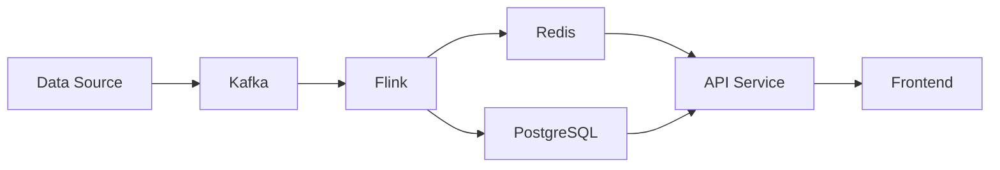

# 项目展示策略

> 打造令人印象深刻的 GitHub 作品集

## 核心原则

### 1. 质量胜于数量
- ✅ 3 个深度项目 > 10 个浅层项目
- ✅ 每个项目都要有完整文档和演示
- ❌ 避免放课程作业或简单 tutorial 代码

### 2. 展示解决问题的能力
- 清晰描述问题和动机
- 解释技术选型和权衡
- 展示迭代和改进过程

### 3. 体现工程素养
- 规范的代码结构和注释
- 完整的测试覆盖
- CI/CD 和部署配置
- 性能基准测试

---

## 项目选择策略

### 推荐项目类型（大数据方向）

#### 1. 实时数据处理系统
**示例**: Real-time Fraud Detection
```
技术栈: Kafka + Flink + Redis + ML Model
亮点:
- 处理 10K events/sec
- 端到端延迟 < 100ms
- ML 模型在线推理
- 完整的监控和告警
```

**为什么好**:
- 展示流处理能力
- 体现系统设计思维
- 涉及多个技术组件集成

#### 2. 数据仓库/数据湖项目
**示例**: Modern Data Lakehouse
```
技术栈: Apache Iceberg + Spark + Trino + MinIO
亮点:
- ACID 事务支持
- Schema evolution
- Time travel 查询
- 性能优化对比（vs Hive）
```

**为什么好**:
- 展示现代数据架构理解
- 体现性能优化能力
- 涉及数据治理考量

#### 3. 数据质量/治理平台
**示例**: Data Quality Framework
```
技术栈: Python + Great Expectations + Airflow + PostgreSQL
亮点:
- 自动化数据校验规则
- 异常检测和告警
- 数据血缘追踪
- Web UI 可视化
```

**为什么好**:
- 展示数据工程全貌
- 体现质量意识
- 解决实际痛点

#### 4. 性能优化工具
**示例**: Spark Query Optimizer
```
技术栈: Scala + Spark + Custom Catalyst Rules
亮点:
- 自动识别慢查询
- 智能分区建议
- 执行计划优化
- 性能提升对比报告
```

**为什么好**:
- 展示深度技术能力
- 体现性能优化思维
- 有量化成果

---

## GitHub Profile 优化

### 1. Profile README

创建 `username/username` 仓库，添加 README.md：

```markdown
# Hi, I'm Alex Chen 👋

## About Me
Senior Big Data Engineer | 6+ years | Spark & Flink Expert

🔭 Currently working on: Real-time data platform at ByteDance
🌱 Learning: Rust for high-performance data processing
💬 Ask me about: Distributed systems, Stream processing, Data modeling
📫 Reach me: alex.chen@email.com

## Tech Stack


## Featured Projects
- [Real-time Fraud Detection](https://github.com/alexchen/fraud-detection) - Flink + ML
- [Data Lakehouse](https://github.com/alexchen/data-lakehouse) - Iceberg + Trino
- [Spark Optimizer](https://github.com/alexchen/spark-optimizer) - Custom Catalyst rules

## Blog
Writing about big data at [alexchen.dev](https://alexchen.dev)
```

### 2. 项目 README 模板

每个项目都应该有清晰的 README.md：

```markdown
# Project Name

[](...)
[](...)

## Overview
Brief description (2-3 sentences)

## Features
- Feature 1
- Feature 2
- Feature 3

## Architecture


## Tech Stack
- Backend: Java 11, Spring Boot
- Data: Spark 3.3, Kafka 3.4
- Storage: S3, Redis
- Deployment: Kubernetes, Docker

## Getting Started

### Prerequisites
- Java 11+
- Docker
- Maven

### Installation
\```bash
git clone https://github.com/user/repo.git
cd repo
mvn clean install
\```

### Running
\```bash
docker-compose up -d
mvn spring-boot:run
\```

## Usage
\```java
// Code example
\```

## Performance
| Metric | Value |
|--------|-------|
| Throughput | 10K events/sec |
| Latency (P99) | < 100ms |
| Availability | 99.9% |

## Project Structure
\```
src/
├── main/
│   ├── java/
│   └── resources/
├── test/
└── docs/
\```

## Contributing
Pull requests are welcome. For major changes, please open an issue first.

## License
[MIT](LICENSE)

## Contact
Alex Chen - alex.chen@email.com
```

---

## 项目深度优化

### 1. 代码质量

#### 代码结构
```
project/
├── src/
│   ├── main/
│   │   ├── java/
│   │   │   └── com/example/
│   │   │       ├── config/      # 配置类
│   │   │       ├── model/       # 数据模型
│   │   │       ├── service/     # 业务逻辑
│   │   │       ├── processor/   # 处理器
│   │   │       └── util/        # 工具类
│   │   └── resources/
│   │       ├── application.yml
│   │       └── log4j2.xml
│   └── test/
│       ├── java/                # 单元测试
│       └── resources/
├── scripts/                     # 部署和运维脚本
├── docs/                        # 文档
│   ├── architecture.md
│   ├── api.md
│   └── deployment.md
├── docker/                      # Docker 配置
│   ├── Dockerfile
│   └── docker-compose.yml
├── .github/workflows/          # CI/CD
│   ├── ci.yml
│   └── deploy.yml
├── README.md
├── CHANGELOG.md
└── LICENSE
```

#### 代码规范
- 统一的代码风格（Google Java Style / PEP 8）
- 完整的 JavaDoc / docstring
- 有意义的变量和函数命名
- 合理的代码注释（解释 why，不是 what）

### 2. 测试覆盖

#### 测试层次
```
单元测试（70%）
├── 测试单个函数/方法
├── Mock 外部依赖
└── 快速执行

集成测试（20%）
├── 测试组件交互
├── 使用测试数据库
└── 验证端到端流程

端到端测试（10%）
├── 测试完整系统
├── 模拟真实场景
└── 性能基准测试
```

#### 测试示例（Java + JUnit）
```java
@Test
void shouldDetectFraudulentTransaction() {
    // Given
    Transaction tx = new Transaction("user1", 10000, "US");
    
    // When
    FraudResult result = fraudDetector.detect(tx);
    
    // Then
    assertThat(result.isFraudulent()).isTrue();
    assertThat(result.getConfidence()).isGreaterThan(0.9);
}
```

#### 覆盖率目标
- 核心业务逻辑：> 80%
- 工具类：> 90%
- 整体项目：> 70%

### 3. CI/CD 配置

#### GitHub Actions 示例
```yaml
name: CI

on:
  push:
    branches: [ main, develop ]
  pull_request:
    branches: [ main ]

jobs:
  build:
    runs-on: ubuntu-latest
    
    steps:
    - uses: actions/checkout@v3
    
    - name: Set up JDK 11
      uses: actions/setup-java@v3
      with:
        java-version: '11'
        distribution: 'temurin'
    
    - name: Build with Maven
      run: mvn clean package
    
    - name: Run tests
      run: mvn test
    
    - name: Code coverage
      run: mvn jacoco:report
    
    - name: Upload coverage
      uses: codecov/codecov-action@v3
```

### 4. 文档完善

#### 必备文档
1. **README.md** - 项目概览和快速开始
2. **ARCHITECTURE.md** - 系统架构设计
3. **API.md** - API 文档（如适用）
4. **DEPLOYMENT.md** - 部署指南
5. **CONTRIBUTING.md** - 贡献指南
6. **CHANGELOG.md** - 版本历史

#### 架构图
使用工具绘制清晰的架构图：
- Draw.io / Diagrams.net（免费）
- Lucidchart（专业）
- Mermaid（代码生成）

Mermaid 示例：


---

## 项目展示技巧

### 1. Demo 视频
- 录制 2-3 分钟的项目演示视频
- 展示核心功能和使用场景
- 上传到 YouTube 或 Bilibili
- 在 README 中嵌入视频链接

### 2. 在线 Demo
- 部署到云平台（AWS/GCP/Azure）
- 提供免费试用或演示账号
- 确保服务稳定可用
- 在 README 中提供访问链接

### 3. 技术博客
- 写 2-3 篇项目相关的技术文章
- 分享设计决策和踩过的坑
- 发布到 Medium / 掘金 / 知乎
- 在 README 中链接相关文章

### 4. 演讲和分享
- 在技术会议上分享项目
- 录制演讲视频
- 在 README 中链接演讲资料

---

## 项目案例研究

### 案例 1: Real-time Fraud Detection System

#### README 亮点
```markdown
## Performance Results
| Metric | Before | After | Improvement |
|--------|--------|-------|-------------|
| Latency (P99) | 500ms | 80ms | 84% ↓ |
| Throughput | 1K/sec | 15K/sec | 15x ↑ |
| Detection Rate | 85% | 95% | 10% ↑ |
| False Positive | 5% | 1.2% | 76% ↓ |

## Architecture Highlights
- Event-driven architecture with Kafka
- Real-time ML inference with TensorFlow Serving
- Stateful processing with Flink
- Low-latency serving with Redis

## Key Learnings
1. Flink's event-time processing is crucial for fraud detection
2. Model serving latency dominates end-to-end latency
3. Backpressure handling is critical for stability
```

#### 为什么好
- 清晰的性能对比
- 技术决策有理由
- 分享学习心得

### 案例 2: Data Lakehouse Platform

#### README 亮点
```markdown
## Why Lakehouse?
Traditional data warehouses are expensive and inflexible.
Data lakes are flexible but lack ACID transactions.
Lakehouse combines the best of both worlds.

## Benchmark Results
Compared to traditional Hive:
- Query performance: 3-10x faster
- Storage cost: 60% reduction
- Data freshness: Hours → Minutes

## Technical Innovations
1. Custom partition pruning algorithm
2. Adaptive query optimization
3. Intelligent caching strategy
```

#### 为什么好
- 解释技术选型的动机
- 提供基准测试结果
- 突出技术创新点

---

## 常见错误

### ❌ 错误 1: 没有 README 或 README 太简单
```markdown
# My Project
Some code I wrote.
```

### ✅ 正确：完整的 README（使用上面的模板）

### ❌ 错误 2: 只有代码，没有文档
- 没有架构图
- 没有使用说明
- 没有设计文档

### ✅ 正确：完整的文档体系
- README + 架构文档 + API 文档 + 部署指南

### ❌ 错误 3: 代码质量差
- 没有注释
- 命名混乱
- 没有测试

### ✅ 正确：生产级代码质量
- 清晰的注释和文档
- 规范的命名
- 完整的测试覆盖

### ❌ 错误 4: 项目太简单
- Hello World 级别的项目
- 课程作业
- Tutorial 代码

### ✅ 正确：有深度的项目
- 解决实际问题
- 涉及多个技术组件
- 有性能优化和测试

---

## 项目检查清单

### 基础检查
- [ ] README.md 完整且清晰
- [ ] 代码可以成功编译/运行
- [ ] 有清晰的安装和使用说明
- [ ] 有 LICENSE 文件

### 代码质量
- [ ] 代码结构清晰合理
- [ ] 有适当的注释和文档
- [ ] 遵循编码规范
- [ ] 有单元测试（覆盖率 > 70%）

### 工程化
- [ ] 有 CI/CD 配置
- [ ] 有 Docker 支持
- [ ] 有依赖管理（package.json / pom.xml）
- [ ] 有版本控制（git tags）

### 文档
- [ ] 有架构图
- [ ] 有 API 文档（如适用）
- [ ] 有部署指南
- [ ] 有 CHANGELOG

### 展示
- [ ] 有 Demo 视频或在线演示
- [ ] 有性能基准测试结果
- [ ] 有技术博客文章
- [ ] GitHub profile 已优化

---

## 下一步

1. 选择 3 个最能展示你能力的项目
2. 按照上述标准优化每个项目
3. 优化 GitHub profile
4. 写 2-3 篇技术博客
5. 准备项目讲解（2 分钟电梯演讲）
