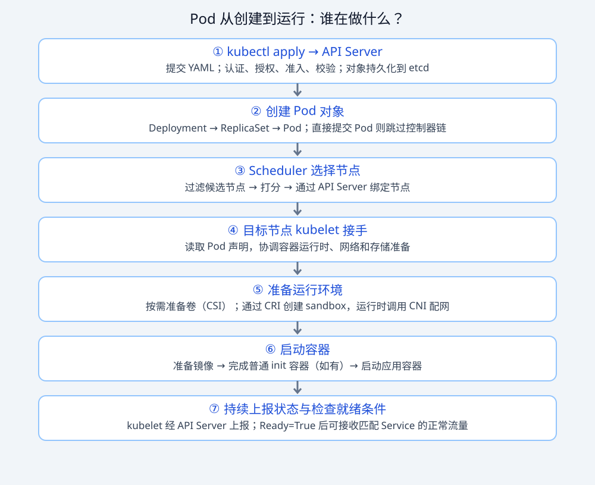
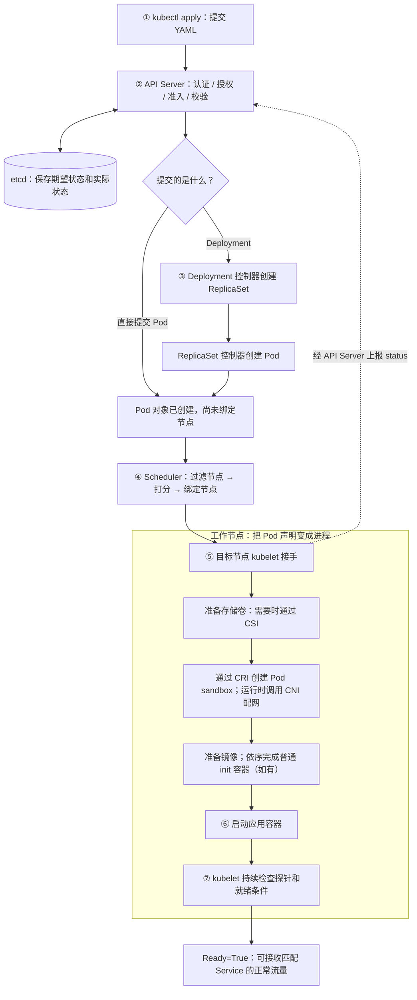
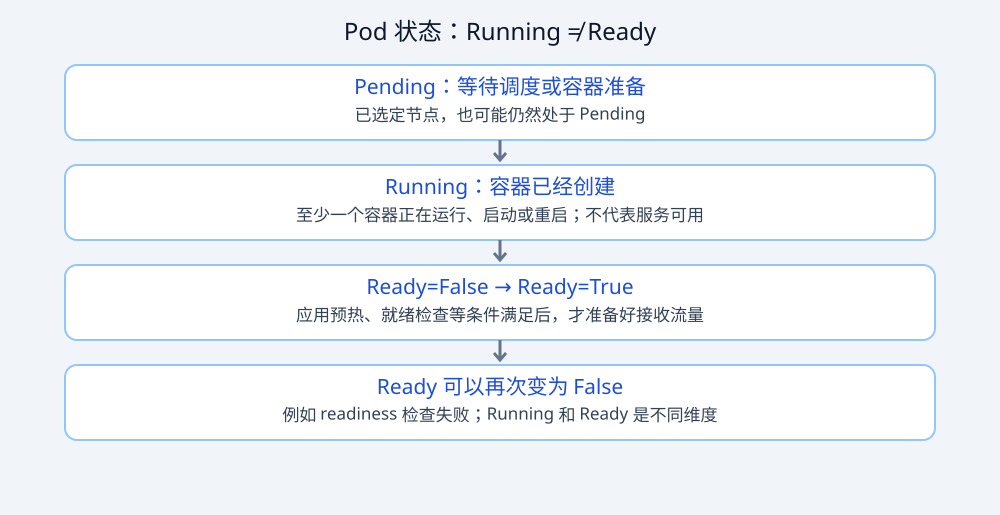

# 01 — Kubernetes 高频 22 题（数据平台岗视角）

> 使用说明：每题四件套 ——【面试官为什么问】【参考回答（40k–50k 档）】【追问链】【动手印证】。
> 数据平台的 K8s 面试和后端岗不同：**面试官默认你是"在 K8s 上跑重资源工作负载（Spark/Flink/模型服务）的人"**，所以调度、资源、GPU、排障的权重远高于写 Operator。

## A. 基础原理层（一面热身，答错直接出局）

### Q1. Pod 从创建到运行，中间发生了什么？

【面试官为什么问】区分"会 kubectl"和"懂 K8s"的第一题。数据平台岗还期待你顺带讲清楚"我的 Spark driver 就是这样被调度的"。

【参考回答】`kubectl apply` 把声明提交给 **API Server**，通过认证、授权、准入和校验后持久化到 **etcd**。如果提交的是 Deployment，Deployment 控制器和 ReplicaSet 控制器会逐层调谐，最终通过 API Server 创建 Pod；直接提交 Pod 则跳过这层。**Scheduler** 为未绑定节点的 Pod 过滤、打分并绑定节点；该节点的 **kubelet** 通过容器运行时、网络和存储插件完成准备并启动容器，持续向 API Server 上报状态。**Running 不等于 Ready**：运行起来后，还要满足就绪条件才能正常接收匹配 Service 的流量。一句话：**声明写进 etcd，控制循环把它变成现实**。

【插图：先看谁负责，再看状态】

查看 Mermaid 源码

> 图中控制器、Scheduler 和 kubelet 都通过 API Server 读写对象；箭头表示处理链路，并非组件直接相互调用。节点准备步骤是简化示意，具体实现可能并行或重试；这里以普通 init 容器为例。

**用开餐馆来记：** API Server 是接单窗口，etcd 是订单账本，控制器负责补齐订单需要的实例，Scheduler 选店址，kubelet 是店长，运行时负责开灶，CNI 接通道路，CSI 接上仓库。**Running 像灶已经开火，Ready 像正式开门迎客。** 第二张图右侧的 Ready 是条件，不是新的 Pod phase。

| 卡在哪里 | 常见现象 | 优先检查 |
| --- | --- | --- |
| 选节点 | Pending，事件出现 FailedScheduling | requests、污点、亲和性、PVC |
| 节点准备 | ContainerCreating / ImagePullBackOff | 镜像地址与凭据、网络、挂卷事件 |
| 应用启动 | CrashLoopBackOff | 容器日志、退出码、启动或存活探针 |
| 应用就绪 | Running，但 READY 显示 0/1 | readiness、依赖服务、应用预热 |

> `ContainerCreating`、`ImagePullBackOff`、`CrashLoopBackOff` 是 kubectl 可能显示的容器等待原因等信息，不是 Pod phase。探针按配置执行；没有 readinessProbe 也仍需满足其他就绪条件。
>
> 官方参考：[Pod 生命周期](https://kubernetes.io/docs/concepts/workloads/pods/pod-lifecycle/)、[三种探针](https://kubernetes.io/docs/tasks/configure-pod-container/configure-liveness-readiness-probes/)。

【追问链】
1. Scheduler 打分打平了怎么办？（随机/按 hash 决定；可以讲 `--percentage-of-nodes-to-score`）
2. kubelet 和 containerd 的关系？（kubelet 是节点代理，通过 CRI 接口调 containerd；讲 CRI/CNI/CSI 三接口）
3. 你的 Spark on K8s 里 driver Pod 是谁创建的？（**加分点**：cluster 模式下是 spark-submit 进程通过 K8s API 创建的，走 ServiceAccount RBAC —— 不是 Scheduler 直接创建"作业"，这个细节能立刻和只会背题的人拉开）

【动手印证】k8s-labs Lab 02（配置一个带探针的 Pod 并 watch 全程）、Lab 10（RBAC + Spark 提交全链路）。

### Q2. liveness、readiness、startup 三种探针的区别？配错会怎样？

【参考回答】startup 只管启动阶段（通过之前其余探针不生效），专治 Flink JobManager、ES 这类慢启动；readiness 失败只摘流量不重启；liveness 失败直接重启容器。经典配错：把慢启动应用只配 liveness 且超时太短 → 初始化中被反复杀 → CrashLoopBackOff。**平台实践**：数据组件一律 startup + readiness 起步，liveness 慎用——把"依赖失败"（连不上下游）误报成 liveness 失败会造成重启风暴。

【追问链】探针失败是重启容器还是重建 Pod？（重启容器，Pod 不变）→ 重建和重启对 Spark executor 有什么区别？（executor 身份/本地 shuffle 数据全丢）

【动手印证】k8s-labs Lab 02（三种探针对照实验 + 反面配置）。

### Q3. Pod 删除时的完整时序？为什么必须配 preStop？

【参考回答】并行两件事：从 Service Endpoints 摘除（异步传播）+ kubelet 执行 preStop → 发 SIGTERM → 等宽限期（默认 30s）→ SIGKILL。坑在"摘除"和"杀"是并行的：应用收到 SIGTERM 立即退出，而摘除还没传播完，在途请求就打到已死 Pod。标准做法：preStop sleep 几秒兜底，宽限期 ≥ 应用最长清理时间。**数据视角**：Flink 最后一次 checkpoint、Kafka offset 提交都活在这条时序里，宽限期设短了就是数据重复/丢失。

【追问链】宽限期设多长合适？（压测应用最长优雅退出时间 ×1.5；我们给 Flink JobManager 设 90s）→ 强杀后如何兜底？（checkpoint 恢复 + 下游幂等）

【动手印证】k8s-labs Lab 02（宽限期 30s vs 2s 的对照实验，能亲眼看到 cleanup done 消失）。

### Q4. Deployment、ReplicaSet、Pod 什么关系？滚动更新原理？

【参考回答】Deployment 管 RS（每次改模板新建一个 RS），RS 管 Pod 副本。滚动更新 = 新 RS 从 0 涨、旧 RS 从 N 落，速率由 maxSurge/maxUnavailable 控制，**readiness 是刹车**。回滚不是撤销操作，是把旧 RS 重新设为期望状态。金丝雀 = pause 控制新旧比例 + Ingress 分流。

【追问链】为什么 Pod 不能原地更新？（不可变性是一致性基石）→ 你的实时作业发布怎么做才不丢数据？（savepoint 停止 → 改镜像 → 从 savepoint 恢复；讲 k8s 上 Flink Operator 的做法）

【动手印证】k8s-labs Lab 03（含"pause 金丝雀"和"失败发布被刹车"实验）。

## B. 资源与调度层（二面主战场）

### Q5. requests 和 limits 的底层是什么？数据作业怎么配？

【参考回答】requests 写进调度账本（节点可分配 = capacity - 已分配 requests），limits 写进 cgroup：内存超限 OOMKilled（exit 137），CPU 超限只是 throttled。**数据作业配置经验**：Spark executor 内存 = 堆 + memoryOverhead（堆外/网络缓冲），limit 给足 overhead 否则无事故也 OOM；JVM 用 `MaxRAMPercentage=75` 留 25% 非堆；CPU limit 对延迟敏感服务慎设（被 throttle 表现为"莫名变慢"）。

【追问链】节点超卖是什么？风险？（requests 之和 > 节点实际资源，用量上来互相挤兑 → 触发驱逐）→驱逐顺序？（BestEffort → Burstable 超用 → Guaranteed）→ 你怎么防？（核心组件 Guaranteed + PriorityClass，大数据作业接受被驱逐但要能恢复）

【动手印证】k8s-labs Lab 05（OOMKilled 137 复现 + 三级 QoS 实测）。

### Q6. Pod 一直 Pending，你的排查 SOP？

【参考回答】`describe pod` 看 Events，调度失败原因明写：`Insufficient memory/cpu`（requests 贪心）、`untolerated taint`（GPU 节点污点）、`node affinity 不匹配`、`PVC 未绑定`。按因施策。**数据平台特有的 Pending**：大作业 requests 填太满 + 节点上已有大镜像的"镜像亲和"把 Pod 钉到满节点——解法是按机型建节点池 + taint 隔离。

【追问链】describe 没有任何 Events？（调度器没轮到/配额不够 ResourceQuota）→ 怎么批量看？（`kubectl get events --sort-by=.lastTimestamp -A`）

【动手印证】k8s-labs Lab 06（三种 Pending 病因 + 污点实验全部复现过）。

### Q7. GPU 在 K8s 上怎么调度？训练和推理有什么不同？

【参考回答】节点装 NVIDIA device plugin（DaemonSet）后 GPU 成为扩展资源，Pod 用 `resources.limits: nvidia.com/gpu: 1` 申请；GPU 节点打污点防普通任务抢占。**训练**：整卡独占、跑完释放，配 Kueue/Volcano 排队；**推理**：QPS 波动大，整卡浪费 → time-slicing 共享（隔离弱）或 MIG 硬隔离（A100/H100 级）；新方向 DRA 按需分配。**成本视角（加分）**：推理服务的真实瓶颈常是 KV Cache 显存而不是算力，vLLM 的 PagedAttention 把利用率拉满后，单卡并发能翻几倍。

【追问链】time-slicing 风险？（一个 Pod 打满 SM 拖累邻居，无算力隔离）→ 怎么监控 GPU？（DCGM exporter + Prometheus，看 SM 利用率/显存/XID 错误）

【动手印证】k8s-labs Lab 06（污点模拟 GPU 节点池）；llmops-labs Lab 08（显存估算方法）。

## C. 存储与有状态（一面常问）

### Q8. PV/PVC/StorageClass 关系？数据库上 K8s 你怎么看？

【参考回答】PVC 提需求、SC 定标准（动态供应）、PV 是交付物。**数据库上 K8s 的表态题**——40k 档必须给辩证答案：中小规模/云盘场景 StatefulSet + 云盘 CSI 成熟可行（快照备份、弹性）；超大规模或强运维习惯的团队，自建在虚机上更稳。关键论据：**RWO 语义**（多数云盘单节点挂载，故障切换要等卸载重挂，秒级 SLA 扛不住）、本地盘的亲和性问题。我们平台的做法：MySQL 走云 RDS，K8s 里跑的是无状态计算和中间件。

【追问链】StatefulSet 和 Deployment 本质区别？（稳定身份+独立存储+有序）→ Headless Service 干嘛的？（DNS 直解析每个 Pod，主从复制点名用）

【动手印证】k8s-labs Lab 04（MySQL StatefulSet 数据存活实验 + 去"存储神秘化"：PV 就是宿主机目录）。

### Q9. 大数据场景的存储坑：Spark/Flink 的 shuffle 和日志怎么管？

【参考回答】三件套：① **shuffle 本地盘**——executor 用 hostPath/emptyDir 挂本地 SSD，节点故障靠重算兜底；② **日志**——容器 stdout 落节点盘会被轮转冲掉，平台标配 sidecar 或 DaemonSet 采集进 ES/Loki，Spark on K8s 里 spark.kubernetes.executor. pod 生命周期结束后日志就没了，必须外采；③ **小文件**——每次executor Pod 新起就是一个新容器，检查点/checkpoint 目录要压 compaction（衔接 Lab 04 Paimon compaction 话题）。

【追问链】为什么不用 PVC 给 executor？（动态副本的 PVC 管理复杂度 >> 收益，stateless 重算更符合 K8s 哲学）

## D. 网络层

### Q10. Service 找到 Pod 的原理？四种暴露方式怎么选？

【参考回答】label selector → Endpoints（自动维护，只收 ready Pod）→ kube-proxy 写 iptables/IPVS 规则 DNAT。暴露方式由内到外：ClusterIP（内部）→ NodePort（调试）→ LoadBalancer（云 LB）→ Ingress（七层按域名/路径，生产标准）。**排障金句**：Service 创建成功 ≠ 服务可用——先看 Endpoints 是否为空（selector 错），再看 Pod readiness。

【追问链】iptables 和 IPVS 的区别与规模阈值？（线性规则 vs 哈希表，Service 上千选 IPVS）→ 集群内 DNS 域名格式？（`svc.ns.svc.cluster.local`；StatefulSet Pod 有独立域名——Kafka/ES 客户端配置的依据）

【动手印证】k8s-labs Lab 07（含一个"流量绕过 Ingress 的假阳性"排障实录——端口冲突，这道题能把排障思路讲出彩）。

## E. 生产排障层（最能拉开差距）

### Q11. 讲一次你处理过的 K8s 生产事故。

【参考回答框架】（用你自己的真实案例，参考 STAR）：现象（监控先报什么）→ 止损（先恢复还是先定位的决策）→ 定位（describe/logs/events 的证据链）→ 根因 → 长效措施（告警/巡检/流程）。
**本手册配套的真实案例可直接引用**（k8s-labs 验证实录改编）："NodePort 端口冲突导致流量绕过 Ingress 的假阳性"——监控和 curl 全绿但流量根本没走新链路，根因是两个 Service 抢同一 nodePort。教训：**链路验证要带"路径唯一性"证明（如临时换个 Host 头），不能只看终点通不通**。

【追问链】怎么防同类问题？（端口分配进 CMDB/命名规范 + 部署后探测要带路径断言）→ 你的告警分级？（P0 作业失败/延迟超 SLA；P1 资源水位；P2 容量趋势）

【动手印证】k8s-labs Lab 08（五种故障急救室，全部故意复现过）。

### Q12. 线上 Pod 频繁重启，你的定位路径？

【参考回答】四步：`get pod` 看 RESTARTS 趋势 → `describe` 看 Last State 的 Exit Code（**137=OOMKilled 查内存构成**：堆外/overhead；**1=应用异常看日志**；**143=SIGTERM 正常退出被探针误判**）→ `logs --previous` 看崩溃前现场 → 复盘 limits 配置和流量变化是否相关。**数据岗加分**：JVM 容器里 137 十有八九是堆外（直接内存/元空间/网络缓冲）吃穿 limit，讲一个你配 MaxRAMPercentage/overhead 的案例。

【动手印证】k8s-labs Lab 05/08（137 复现 + 五病例）。

### Q13. HPA 的原理与坑？数据平台哪里用得上？

【参考回答】每 15s 从 metrics-server 取均值，`期望副本 = ceil(当前 × 实际/目标)`，**分母是 requests 不是 limits**（requests 虚高 HPA 会迟钝）；扩容快、缩容有稳定窗口（默认 300s，实测窗口后可一步落回 min）。**数据平台用法**：无状态查询网关/API 用 CPU HPA；**队列类用 KEDA**（Kafka lag、Flink 反压做指标）；Flink 作业本体不要简单 HPA（状态迁移要 savepoint），要么作业级 rescale 要么按 lag 触发 + 重启恢复。

【追问链】metrics-server 挂了 HPA 会怎样？（读不到指标保持现状，不会缩容——设计如此）→ 自定义指标怎么接？（Prometheus Adapter / KEDA scaler）

【动手印证】k8s-labs Lab 09（扩容 2→8 实测 + 缩容稳定窗口实测）。

## F. 平台化层（二面/三面加分项）

### Q14. 你们的数据平台为什么（不）要上 K8s？迁移踩过什么坑？

【参考回答】**要上的理由**：资源弹性（潮汐混部）、部署标准化（所有组件同一套发布/监控/告警）、和云原生生态（监控/日志/网关）打通。**代价要主动说**：YARN 习惯翻译成 K8s 语言的成本（shuffle、动态资源分配、日志采集）、镜像与 RBAC 管理、排查链路变长（Pod 生命周期 + cgroup + 网络）。**踩坑示例**：executor OOMKilled 率比 YARN 时代高——因为 YARN container 和 Pod 的内存语义差异（cgroup 直杀 vs NM 杀进程），解法是统一 executor 内存模板（堆 75% + overhead 20%）。

【追问链】混部怎么防互相影响？（namespace 配额 + PriorityClass + 污点隔离在线/离线节点池）

【动手印证】k8s-labs Lab 10（Spark on K8s 全链路 + 三个镜像级坑）。

### Q15. Spark on K8s 和 on YARN 的架构区别？怎么选？

【参考回答】调度权交 kube-scheduler，资源单位 Container→Pod，ApplicationMaster→driver Pod（通过 SA 调 API 创建 executor，需要 RBAC：pods/services 的 create/update/**patch**/delete——patch 最容易漏，实测踩过）。**选型**：已有稳定 YARN 且无强云原生诉求 → 迁移收益 < 成本；多云/弹性伸缩/和 AI 负载混部 → K8s。**架构细节（加分）**：executor 容器 args 只有 `["executor"]`，真正进程由镜像 entrypoint 拉起 KubernetesExecutorBackend，driver URL 等全部环境变量注入——能讲到这层说明真的读过 pod spec。

【追问链】dynamic allocation 在 K8s 上怎么办？（外部 shuffle service 没有了，用 shuffle tracking，3.4+ 已较成熟）→ 镜像怎么管？（基础镜像统一层缓存，按 Spark 版本 + JDK + 补丁分层）

【动手印证】k8s-labs Lab 10（本地构建官方等价镜像的三个坑：chown/entrypoint/PATH）。

### Q16. RBAC 怎么设计？数据平台的账号体系？

【参考回答】原则：**ServiceAccount 最小权限 + namespace 隔离 + 不给 cluster-admin**。数据平台实践：每个计算引擎一个 SA（spark/flink/airflow 各自 Role）；CI/CD 用独立 SA 只能发布特定 namespace；人工运维走 OIDC + 组映射。**案例**：Spark driver 需要 `services` 的 patch 权限，只给 create 时提交报 Forbidden——最小权限的"最小"要靠实测迭代，不是拍脑袋。

【动手印证】k8s-labs Lab 10（RBAC 实战 + 权限不足的完整报错分析）。

### Q17. ConfigMap/Secret 的坑？数据平台配置怎么管？

【参考回答】ConfigMap 挂载异步同步（约 1 分钟）且目录挂载会遮盖原目录；Secret 只是 base64 不是加密，etcd 层要开加密。**平台实践**：环境配置走 GitOps（Git 为准），敏感信息接 Vault/云 KMS，配置变更带版本与回滚。**数据岗特色**：Hive site/spark-defaults 这类大配置文件用 ConfigMap 挂载 + StatefulSet 滚动生效，比进镜像灵活。

### Q18. Ingress 和 API 网关的区别？你们的组件怎么暴露？

【参考回答】Ingress 是七层流量入口（域名/路径/TLS）；API 网关多了鉴权/限流/审计。数据平台暴露清单：Airflow/Spark History/Grafana/Superset 走 Ingress + SSO；内部服务互调用 ClusterIP；对下游系统的数据服务走 API 网关 + token。**坑**：NodePort 端口冲突会让流量"看似通实则绕路"——验证链路要带路径唯一性断言（k8s-labs Lab 07 实录）。

### Q19. etcd 在 K8s 里的角色？为什么重要？

【参考回答】唯一有状态的"真源"，所有对象的存储。Raft 强一致，watch 驱动整个控制循环。运维红线：etcd 磁盘延迟 > 10ms 全集群变慢；对象总数与 watch 数是容量瓶颈（单集群 ~5000 节点量级）。**数据岗关联**：我们大量 CRD（SparkApplication/FlinkDeployment）都存 etcd——大作业的 podspec 别往 annotation 里塞太多数据。

### Q20. kind/minikube 和生产集群的差别？你平时怎么自测？

【参考回答】kind = 单容器节点，共享本机镜像，无真实网络/存储/多节点调度——适合功能与 YAML 验证，不适合性能与高可用验证。我的自测流程：**kind 验证正确性 → 预发集群验证资源/网络 → 生产灰度**。加分：能说出 kind 的 local-path 存储、NodePort 端口映射这些"和生产的差异点"。

【动手印证】两个课程仓库全部实验都在 kind 上完成，且文档里标注了每处"与生产的差异"。

### Q21. K8s 1.3x 新版本有什么值得关注的变化？（考察是否持续跟进）

【参考回答】挑和自己相关的：**Sidecar 容器转正**（原生 sidecar，解决采集 agent 生命周期）、**DRA 动态资源分配**（GPU 等资源按需分配，替代 device plugin 的方向）、**Gateway API 成熟**（替代 Ingress 的下一代）、PodDisruptionBudget 与 kueue/volcano 生态在 AI 场景的演进。诚实策略：说"我在跟进的方向"而不是装全知。

### Q22. 如果让你负责把 200 个离线作业从 YARN 迁到 K8s，怎么做？

【参考回答】（架构题，按步骤答）① 盘点：作业清单/资源画像/依赖（YARN 队列语义、HDFS 访问）；② 镜像化：统一基础镜像（Spark 版本+JDK+监控 agent 分层）；③ 灰度：先非核心报表 → 按队列分批，双跑对比数据正确性与耗时；④ 平台化：YAML 模板 + 提交网关，让用户无感；⑤ 治理：namespace/配额/优先级映射原队列语义；⑥ 回滚预案：保留 YARN 双跑 2 周。**量化目标先行**：资源利用率提升 X%、成本下降 Y%——先定度量再动手。

【动手印证】k8s-labs 全部实验即"第②步"的完整彩排。

## G. 进阶追问库（10 题，二面深水区）

### Q23. init 容器和原生 Sidecar 的区别？
init 容器串行跑完再启动主容器；**原生 Sidecar**（1.28+，`initContainers` + `restartPolicy: Always`）在主容器前启动且**全程存活**——解决经典难题：日志采集 agent 必须先于业务容器就绪、且业务退出后最后一批日志要能采完。数据平台的日志采集、service mesh envoy 都受益。

### Q24. PV 的回收策略三种？数据平台怎么选？
Retain（保留人工处理，数据库用）/ Delete（随 PVC 删，动态供应默认）/ Recycle（废弃）。**实践**：核心数据表存储一律 Retain + 备份；测试环境 Delete 让资源自动回收。

### Q25. NetworkPolicy 解决什么问题？默认网络是什么样？
K8s 默认**全通**（Pod 互相可达无限制）。NetworkPolicy 用 label 选择器定义三层/四层白名单——数据平台场景：限制"只有 Airflow SA 的 Pod 能连数据库"、隔离租户 namespace。前提：CNI 要支持（calico/cilium 支持，flannel 不支持——flannel 只做 overlay 网络）。

### Q26. flannel / calico / cilium 的区别？
flannel：简单 overlay（VXLAN），无网络策略；calico：BGP 三层路由 + 网络策略，性能好；cilium：eBPF 数据面，性能与可观测性最强（服务网格/安全策略可编程）。**选型口径**：小集群 flannel 够用；要策略选 calico/cilium；大规模+可观测诉求 → cilium。

### Q27. PodDisruptionBudget（PDB）和 PriorityClass 分别保护什么？
PDB 保护**主动驱逐**场景（节点维护时至少保留 N 个副本可用）——没有 PDB，drain 一个节点可能同时杀掉某服务全部副本；PriorityClass 保护**资源不足驱逐**场景（高优先级后驱逐）。两者配合：核心组件 PriorityClass 高 + PDB 设 minAvailable。数据平台落地：监控/调度组件最高优先级，核心 Flink 作业次之，批任务最低。

### Q28. CRD 和 Operator 是什么？数据平台哪里用？
CRD = 自定义资源类型（把"一个 Spark 作业"变成 K8s 对象）；Operator = 用控制器模式管理这些对象的程序（监听 CR 变化 → 调谐到现实）。数据平台实例：SparkOperator 的 SparkApplication、Flink Kubernetes Operator 的 FlinkDeployment、Airflow 的 Helm 化——**Operator 化的价值：作业状态管理（失败重启/升级/savepoint）从人工变成声明式**。追问预警：自己写 Operator 的门槛（要处理幂等、状态机、版本升级），优先用成熟 Operator。

### Q29. Pod 安全怎么加固？
securityContext（runAsNonRoot、readOnlyRootFilesystem、drop capabilities）+ namespace 级 Pod Security Admission（privileged/baseline/restricted 三档）+ 镜像扫描（trivy）+ Secret 加密。**数据平台风险点**：数据作业常需要大页面/共享内存（IPC）、挂载主机路径——按 workload 分级放行，默认收紧。

### Q30. 大规模集群（数千节点）的调优点？
etcd 是瓶颈（事件与 watch 压力）→ 控制器限流、减少高频 status 更新；镜像预分发（P2P 分发）；调度器分片；大对象（ConfigMap >1MB）会拖垮 etcd——大数据作业的"作业清单"用 CRD 而不是把所有内容塞 ConfigMap。

### Q31. kube-proxy 三种模式的本质差异？
userspace（古早，性能差）→ iptables（线性规则匹配，Service 万级时规则更新慢且延迟上升）→ **IPVS**（内核哈希表 + 真实 LB 算法 rr/lc/sh，支持大规模）。排查"Service 间歇性不通"时先确认模式与规则同步状态。

### Q32. 你们的 K8s 集群版本怎么升级？有状态数据组件怎么办？
小步升级（1.2x → 1.2x+1，不跨版本）；顺序：控制面 → 存量节点逐个 drain（PDB 保护）→ 验证。数据组件策略：**优先滚动无状态部分**，MySQL/ES 类有状态组件在独立版本节奏（甚至独立集群），不跟 K8s 升级绑定。演练：预发集群先跑全量 workload 一周。

---

# 深挖补充（防问倒版）：机制细节与追问实录

## 深挖 1：CPU throttling 的底层原理——"CPU 没满但很慢"的真凶

**机制**：K8s 的 CPU limit 通过内核 **CFS（Completely Fair Scheduler）配额**实现——以 100ms 为一个周期（cfs_period），limit=500m 意味着每 100ms 只能用 50ms CPU。**用完即停**：本周期内该容器所有线程被暂停，直到下个周期。

**经典故障**：Java 应用 GC 多线程并行回收，瞬间 8 线程 × 100ms 用完 500ms 配额 → **本周期剩余时间全部被节流** → 监控上 CPU 使用率才 40%（按周期平均），但请求延迟出现 100ms 级毛刺。这就是"CPU 没满但 P99 毛刺"的标准答案。

**排查**：`kubectl exec` 里看 `/sys/fs/cgroup/cpu/cpu.stat` 的 `nr_throttled/throttled_time`（cgroup v1）或 `cpu.stat` 的 `nr_throttled`（v2）；Prometheus 的 `container_cpu_cfs_throttled_periods_total`。

**解法**：① 提高 limit（治标）；② 应用侧限制并行度（如 JVM 的 `-XX:ActiveProcessorCount=容器配额核数`，防止 GC/线程池按宿主机核数开线程）；③ 对延迟敏感服务**去掉 CPU limit**（只保留 requests，靠节点容量兜底——需团队共识，这是真实生产的常见取舍）。

【追问实录】"requests 和 limit 不一致（如 200m/2核）会怎样？" 答：调度按 200m 算，运行时可 burst 到 2 核；节点紧张时被压缩回 requests——Burstable 的语义。GUI 监控"使用率"若按 limit 算会误判。

## 深挖 2：Service 的数据平面——iptables 规则结构与 conntrack

**iptables 模式**：每个 Service 生成一条 KUBE-SERVICES 链规则（目标 IP 匹配 → 跳 KUBE-SVC-XXX 链）→ KUBE-SVC-XXX 按概率模块（random --probability 1/N）分发到各 KUBE-SEP-XXX（DNAT 到具体 Pod IP:Port）。**缺点**：规则线性匹配（O(n)）、更新全量重刷、扩到几万 Service 时延迟显著。

**conntrack（连接跟踪表）**：DNAT 依赖内核 conntrack 记录"这条连接原来去哪"。**生产事故源**：conntrack 表满（`nf_conntrack_max`）→ 新连接被丢——表现为"部分 Pod 随机连不上 Service"。大数据场景：一个 Spark executor 短时间向 HDFS/Kafka/Redis 建几十万短连接 → conntrack 爆表。解法：连接池复用、调大 nf_conntrack_max、或 IPVS（ conntrack 仍需但管理更高效）。

【追问实录】"Pod A 连 Service B 时快时慢，怎么定位？" 答：① 进入 Pod 抓包看 DNAT 前后（tcpdump 双端）；② 查 conntrack 计数与超时；③ 对比 IPVS/iptables 模式与 Endpoints 变化时间——我经历过的一次是 Endpoints 更新后 iptables 同步延迟 30s+，大并发下出现"新 Pod 没流量、旧 Pod 被打死"的假负载均衡。

## 深挖 3：HPA 的完整指标链路与延迟

**链路**：容器 cgroup（cAdvisor，kubelet 内嵌）→ kubelet Summary API（:10250/metrics/resource）→ metrics-server 抓取聚合（15s 间隔，内存存最近几分钟）→ metrics.k8s.io API → **HPA 控制器**（每 15s 调谐一次）→ scale 子资源 → Deployment 改 replicas。

**延迟拆解**：指标产生（即时）→ metrics-server 采集（最多 60s）→ HPA 调谐（15s）→ Pod 创建 → **启动+就绪（最大头，可能分钟级）**→ 流量进来。所以"扩容生效"至少 30s~几分钟——**容量规划要覆盖这个空窗**，这就是为什么大促前要提前扩容而不是靠 HPA 临时拉。

【追问实录】"HPA 用的 CPU 是哪个时刻的？" 答：最近一次 metrics-server 采样的**平均值**（所有副本的 CPU 利用率均值），且 HPA 会忽略"窗口太老"的样本；扩容后还有 **scale-up 冷却**（v2 behavior 可配）防抖动。

## 深挖 4：etcd 的 MVCC 与 watch——为什么它是集群的"心脏"

**MVCC**：每个 key 保留多版本（每次修改全局 revision 递增），历史版本靠 **compaction** 清理——compaction 不做会膨胀（磁盘满 → 集群只读）。**watch**：客户端从某 revision 开始订阅变更事件——整个 K8s 的控制循环（kubelet/调度器/控制器）都靠 watch 而不是轮询，etcd 的 watch 吞吐直接决定控制面响应速度。

**数据岗关联**：每次 `kubectl apply` 一个大 YAML（比如塞了大量 label 的 Spark 作业）都会进 etcd 并触发一串 watch 广播——"大对象别进 etcd"的依据。运维红线：etcd 磁盘延迟（fsync）>10ms 就要告警；`etcdctl alarm list`、定期 compact + defrag。

【追问实录】"apiserver 和 etcd 挂了一个会怎样？" 答：apiserver 多副本无状态可自愈；etcd 挂 = 集群失去"真源"——**已运行的 Pod 继续跑**（kubelet 按最后已知状态工作）但无法新建/变更/探针上报异常，是"半可用"状态——恢复后追赶。这个"半可用"认知是区分度所在。

## 深挖 5：StatefulSet 的有序性与"不能随意乱序"的代价

**机制**：按序创建（i-1 就绪才建 i）、按序删除（从最大序号开始）、稳定身份（podName + PVC 模板）。**代价**：扩容快、缩容极慢且必须从尾部；mysql-0 挂了 mysql-1 正常但 mysql-1 不能先于 mysql-0 重启（对某些主从语义）。

**生产取舍**：`podManagementPolicy: Parallel`（并行创建，适合 ES/Kafka 这类不依赖严格顺序的）+ `partition` 控制"只滚动部分序号"（灰度发布用）。**数据岗关联**：Kafka broker 缩容顺序（先迁分区再缩 Pod）——StatefulSet 只管 Pod 序，不管业务语义，业务语义要靠 operator/人工流程补。
