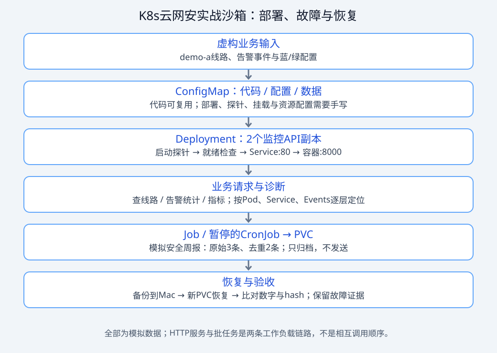

# 云网安业务沙箱：先把服务弄坏，再独立恢复

这是为中企通信员工设计的**虚构训练场景**：网络监控查询API、安全告警统计、报告归档和故障采集器。不连接真实网络、SOC、云账户或客户数据，不代表公司实际系统架构或SLA。

主线复用 `python:3.12-alpine`，只用Python标准库，不需要先搭Kafka、Doris或模型服务。代码通过ConfigMap挂载以减少初学环境成本；掌握后再将代码打入镜像。快速路线见 [6次实战](FAST-TRACK.md)，故障任务见 [实战任务册](DRILLS.md)。



## 10分钟获得健康基线

所有命令从k8s-labs目录执行，Docker与kind-labs需已运行：

```bash
cd /Users/hp/Documents/ai-labs/k8s-labs
kubectl --context kind-labs get nodes
python3 business/labctl.py up
python3 business/labctl.py verify
```

如果没有labs，先按根README创建；若Python镜像不可用，运行 `bash hack/prepare-images.sh`，确认该镜像拉取且load成功后重试。此脚本不会创建集群或替你修网络。

up只创建固定的 `kind-labs / cec-k8s-practice`。同名namespace若没有本工具的所有权标签会拒绝操作，避免接管已有资源。没有覆盖namespace/context参数；多节点和真实网络策略另走Lab13/14。

预期：2个Ready副本；验证输出 `raw_count=3`、`unique_count=2`，两条demo-a线路，最后PASS。业务时间固定在fixture内，方便重现；这里是短窗口统计，不是实际自然周数据。

验证不仅看Pod Running，还检查发布已完成、EndpointSlice有Ready后端，并从Pod通过Service访问实际业务。**直接port-forward到Pod不能证明Service selector/targetPort正确。**

## 看见实际业务

另开一个终端：

```bash
kubectl --context kind-labs -n cec-k8s-practice port-forward service/monitor-api 18080:80
```

浏览器打开 [线路查询](http://127.0.0.1:18080/api/circuits)、[告警统计](http://127.0.0.1:18080/api/summary)、[配置对照](http://127.0.0.1:18080/config)。port-forward只作观察窗口，服务故障判断用verify与集群内请求；重建Pod后可能要重开转发。

## 每个故障练习的固定流程

```bash
python3 business/labctl.py verify
python3 business/labctl.py fault selector
python3 business/labctl.py capture --output business/work/selector-before
python3 business/labctl.py verify
```

最后一条应失败且退出码非零。先自己修改Service修复，并运行verify；保留修复diff与证据。实在卡住再看DRILLS中的折叠提示。最后核对健康配置：

```bash
python3 business/labctl.py recover
python3 business/labctl.py verify
```

recover会恢复API/ConfigMap/Service，重启API使环境变量一致，删除沙箱HPA、负载、OOM/崩溃练习Pod；**不会删除批任务、归档PVC或RBAC**。不是业务回滚示范，不能替代独立定位和最小修复。每次只选一个fault，别叠加。

## 可直接注入的9个场景

| fault参数 | 业务现象 | 要区分的机制 |
|---|---|---|
| selector | 平台API访问失败 | Pod健康但Service选不到后端 |
| port | 后端存在但请求失败 | targetPort与实际监听端口不符 |
| readiness | 新版本发布停滞，旧服务仍可能可用 | 发布就绪条件与应用存活 |
| image | 新副本拉镜像失败 | 镜像来源、tag、网络与缓存 |
| pending | 新副本无节点可放 | requests/limits合法，但请求超过容量 |
| config | 配置文件变green，环境变量仍blue | 文件更新、应用读取和进程环境快照 |
| dependency | Running但退出Service，进程不应因依赖失败重启 | readiness与liveness职责 |
| crash | 独立采集器反复exit 2 | 应用退出、历史日志与退避 |
| oom | 独立消费者被内存上限终止 | OOMKilled证据，不只看exit 137 |

注入后异步收敛，不能立即凭一帧截图下结论；尤其ConfigMap要等节点投影更新。readiness/image/pending采用maxUnavailable=0，旧副本通常还服务，不能把“页面能打开”当作发布成功。

## 运行模拟安全周报

```bash
python3 business/labctl.py report
python3 business/labctl.py report
```

自动创建练习PVC与暂停的CronJob，然后手动创建一次Job并校验JSON。首次归档created，再次同内容existing。CronJob固定暂停；不会真的发周报。并发/崩溃时的完整幂等与一致性尚未实现，见DRILLS。

## 工具、应用与K8s对象的关系

- `app/`：server.py提供HTTP，domain.py负责过滤/统计，report.py负责统计和本地文件归档。
- `fixtures/`：虚构线路/事件及配置；首次up把它们写入ConfigMap。
- `manifests/api.yaml`：SA、2副本Deployment、Service、三探针、非root和资源限制。
- `manifests/batch.yaml`：PVC、暂停的CronJob；report命令从其模板建Job。
- `manifests/hpa.yaml`、`load.yaml`：可选扩缩容训练，需Metrics API；负载最多120秒。
- `manifests/rbac.yaml`：只允许SA读取指定ConfigMap的授权对照；API本身不需K8s token。
- `archive-reader.yaml`、`archive-restore.yaml`：归档备份/恢复的独立卷练习。
- `labctl.py`：部署/受控注入/集群内验收/采证/恢复/清理；不修改系统组件、节点或其他namespace。

## 清理与本地测试

```bash
python3 -m unittest discover -s business/tests -v
python3 business/labctl.py clean
```

clean删除专用namespace及其中所有练习对象，PVC可能按存储策略触发卷删除，先导出需要的证据和归档；不会删除kind集群。离线HTTP测试监听本机临时端口，不能用纯语法检查替代。

## 边界

API无真实认证，DEMO_TENANT是固定环境值，过滤演示不等于多租户安全；ConfigMap里放代码只是学习捷径。依赖故障通过配置模拟，不是实际探测云/网络。local-path卷不是异地备份，单节点双副本不是高可用。Kafka消费积压、真实CSI、云负载均衡、NetworkPolicy需对应环境，练习中明确区分，不用模拟结果声称生产验证。
