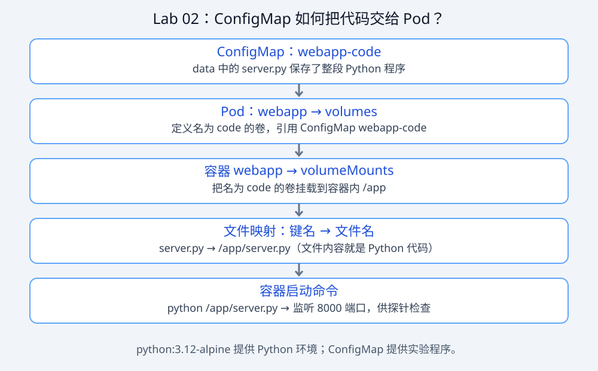

# Lab 02 — Pod 的完整生命周期：探针与优雅终止

> **云网安业务实战：[本章业务任务](BUSINESS-PRACTICE.md)**。先走6次快速路线，再补本章细节；旧PRACTICE保留作进阶考核。


> **新版必做入口：[手写、生产故障与验收](PRACTICE.md)**。先理解本页示例，再合上参考独立完成练习；只跑通示例不算过关。


## 📖 本章学习指导

> 建议时长 **2.5 小时** ｜ 前置：Lab 01 ｜ 关联面试：`interview-prep/01-kubernetes.md` Q2-Q3

**学习循环：**
1. **读**（20min）：原理速讲的"Pod 创建链路"和"优雅终止时序"两段要能复述
2. **跑**（40min）：务必开**两个终端**（一个 `get pod -w`，一个 `logs -f`）——单终端看不到过程
3. **破坏练习**（30min，本章精华）：① livenessProbe 路径改成 `/x`，亲眼看 CrashLoopBackOff 与重启退避间隔变长；② 宽限期改 2s，看日志里 `cleanup done` 永远消失；两个都修回来
4. **验收自测**：① Pod 创建全链路？② 三种探针配错各自的后果？③ preStop 为什么 sleep？④ 137 与 143 区别？
5. **产出**：手画"删除 Pod 的完整时序图"（拍照存进学习笔记）

**常见卡点**：单终端看不到过程 → 一定开两个终端；ConfigMap 改了不生效 → 区分挂载文件同步与程序重载，见 PRACTICE

## 学习目标

- 能完整讲述 **Pod 从创建到销毁的全流程**（理解 K8s 运行机制的钥匙，也是最常被问到的原理题）
- 分清三种探针（startup/readiness/liveness）的职责，知道配错的后果
- 亲眼看到**优雅终止的完整时序**：preStop → SIGTERM → 宽限期 → SIGKILL
- 理解这套机制对数据人的意义：Flink checkpoint、Kafka offset 提交都依赖优雅终止

## 核心问答

**Q1：一个 Pod 从 `kubectl apply` 到 Running，中间发生了什么？**

> 参考答法（背熟这条链路）：① 提交到 **API Server**，校验后写入 **etcd**；② **Controller Manager**（Deployment/ReplicaSet 控制器）负责"期望副本数 vs 实际数"的调谐；③ **Scheduler** 给未调度的 Pod 挑节点（过滤不满足资源的节点 → 打分选最优），把节点写回 Pod；④ 对应节点的 **kubelet** 监听到 Pod，调用容器运行时（containerd/CRI）拉镜像、创建容器，调用 **CNI** 插件配网络、**CSI** 挂存储；⑤ 探针通过、状态上报 API Server，Pod 变 Running。一句话：**声明式写入 etcd，控制循环逐层调谐到现实**。

**Q2：三种探针的区别？配错会怎样？**

> 参考答法：**startupProbe** 只在启动阶段工作，通过之前其他探针不启动 —— 专治慢启动应用（大数据组件启动普遍慢，Flink JobManager、ES 都需要）；**readinessProbe** 决定"接不接流量"，失败只是从 Service 后端摘除，**不重启**；**livenessProbe** 决定"活没活着"，失败会**重启容器**。最经典的配错：把慢启动应用只配 liveness 且 timeout 太短 → 应用还在初始化就被反复杀 → CrashLoopBackOff。

**Q3：Pod 删除时发生了什么？为什么要配 preStop？**

> 参考答法：删除 Pod → Pod 被标记 Terminating 并**并行**做两件事：① 从 Service **Endpoints 摘除**（异步，需要时间传播）；② kubelet 执行 preStop 钩子，然后发 **SIGTERM**，等 `terminationGracePeriodSeconds`（默认 30s），超时 **SIGKILL**。坑在于①②是并行的 —— 如果应用收到 SIGTERM 立即退出，而摘除还没传播完，正在处理的请求就会打到已死的 Pod。所以标准做法：**preStop 里 sleep 几秒，给摘除留时间，再让应用做真正的清理**。

## 原理速讲

探针的本质：kubelet 按周期对容器做检查（HTTP GET / TCP / exec），按 `failureThreshold × periodSeconds` 判定失败。本实验用 HTTP 探针，应用 10 秒后才 ready。

优雅终止时序（本实验要亲眼看到的）：

```
kubectl delete pod
  ├─ Pod 标记 Terminating，从 Endpoints 摘除（并行传播中）
  ├─ preStop 钩子执行（sleep 2s）
  ├─ 发送 SIGTERM → 应用开始清理（我们的应用需要 3s）
  ├─ 宽限期倒计时（我们设 30s）
  └─ 应用正常退出（或超时 SIGKILL 强杀 → 清理代码没跑完 → 生产事故）
```

## 动手实验

### ConfigMap 和 Pod 的关系

本实验把 Python 程序放进 ConfigMap `webapp-code`，通过 Pod 的 `code` 卷挂载为 `/app/server.py`，再由容器里的 Python 执行。这里保存的是实验代码，而非普通配置；这样无需单独构建应用镜像。



ConfigMap 与 Pod 是两个独立对象，通过名称引用，需位于同一命名空间。文件更新不等于正在运行的 Python 程序自动重新加载。

### 1. 部署（先 apply ConfigMap 再 Pod）

```bash
cd lab02-pod-lifecycle
kubectl apply -f manifests/
```

### 2. 观察"慢启动"如何被 startupProbe 接住

```bash
kubectl get pod webapp -w
```

预期时序（另开终端 `kubectl logs -f webapp` 更直观）：

```
NAME    READY   STATUS    RESTARTS   AGE
webapp  0/1     Running   0          5s     ← 容器已跑，但 READY 0/1（readiness 未过）
webapp  1/1     Running   0          14s    ← 10 秒后应用 ready
```

日志里能看到 `>>> serving on 8000` → 10 秒后 `>>> now READY`。

> 观察：STATUS 一直是 Running 而不是 Waiting —— **readiness 不过不影响容器运行，只影响接流量**。这是三种探针区别最直观的体现。

### 3. 验证探针行为

```bash
# 等应用 ready 后，从集群内访问探针路径
kubectl run curl --rm -it --image=curlimages/curl --restart=Never -- http://webapp:8000/ready
# ↑ 会失败！普通 Pod 没有这种 DNS（那是 Service 的待遇），Lab 07 会讲
# 正确的验证方式：直接看探针结果
kubectl describe pod webapp | grep -A 8 "Containers:"
kubectl get pod webapp
```

### 4. 优雅终止：删 Pod，看完整时序

```bash
# 终端 1：盯着事件流
kubectl get pod webapp -w

# 终端 2：触发删除，立刻看日志
kubectl delete pod webapp
# 删除过程中快速执行：
kubectl get pod webapp   # STATUS=Terminating
kubectl logs -f webapp   # 预期依次出现：
# >>> SIGTERM received, cleaning up (takes 3s)...
# >>> cleanup done, exiting
```

注意：**preStop 的输出不在容器日志里**（preStop 由 kubelet 在容器外执行），要看它是否执行了：

```bash
kubectl get events --field-selector involvedObject.name=webapp | grep preStop
# 预期：Executing preStop hook
```

删除完成后确认容器是正常退出（exit code 0）而非被杀：

```bash
kubectl get pod webapp -o yaml | grep -i "finishedAt"   # 删除完成后 Pod 已消失，可看 Events 里的 Killing
```

### 5. 反面实验：宽限期太短会怎样

Pod 的宽限期创建后不可 patch，直接改文件重新部署（把 30 秒改成 2 秒，比应用清理需要的 3 秒还短）：

```bash
# 第 1 步：把清单里的 30 秒改成 2 秒（用 PyCharm/编辑器打开 manifests/02-pod.yaml 手改更好理解；
#         下面这行 sed 的含义 = "把文件里的 30 替换成 2"，改的是内存中的副本再交给 kubectl）
sed 's/terminationGracePeriodSeconds: 30/terminationGracePeriodSeconds: 2/' \
  manifests/02-pod.yaml | kubectl apply -f -
# 第 2 步：等应用 ready（应用有 10 秒慢启动，startupProbe 在工作）
sleep 15
# 第 3 步：删除并等 8 秒（宽限期 2 秒 + 删除传播时间）
kubectl delete pod webapp >/dev/null && sleep 8
# 第 4 步：看上一次容器的日志尾部（--previous = 看已死容器的现场）
kubectl logs webapp --previous 2>/dev/null | tail -2
```

预期：日志停在 `SIGTERM received...`，**永远看不到 `cleanup done`** —— 宽限期一到被 SIGKILL。对应生产场景：Flink 的最后一次 checkpoint 没保存、Kafka offset 没提交，重启后数据重复。**结论：宽限期 ≥ 应用最长清理时间**。改完记得还原（重新 `kubectl apply -f manifests/02-pod.yaml` 前先把 sed 改回去，或直接 `kubectl delete` 后从 git 恢复）。

### 清理

```bash
kubectl delete -f manifests/
```

## 观察与思考

1. `kubectl get pod -w` 时，AGE 和 READY 字段分别由谁决定？（AGE=创建时间；READY=ready 容器数/总容器数，readinessProbe 决定）
2. Pod 里能不能跑两个容器？什么时候需要？（sidecar：日志收集、service mesh 代理；Lab 10 的 Spark 集群日志采集就是这么做的）
3. `--previous` 参数为什么重要？（容器重启后，上一次崩溃现场的日志只能靠它看 —— 排障必备）

## 常见坑

- readinessProbe 和 livenessProbe 指向同一个路径是常见做法，但**别把"依赖失败"（如连不上数据库）做成 liveness 失败** —— 依赖抖动会引发重启风暴，依赖问题应该用 readiness
- ConfigMap 目录挂载异步更新，延迟受 kubelet 同步与缓存策略影响；Python 已启动的程序不会因此自动重新加载；且挂载目录会**遮住**原目录内容（所以 `/app` 下只有 server.py）
- Apple Silicon 上 python:3.12-alpine 首次拉取约 15MB，若网络慢可先 `docker pull python:3.12-alpine`
